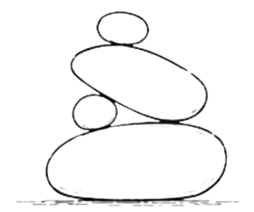
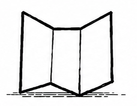
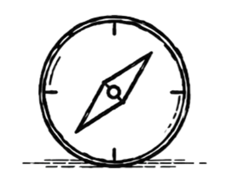

<section class="slab-talks" aria-labelledby="slab-talks-title">
  <aside class="slab-rail" aria-label="Site navigation">
    <nav class="slab-index" aria-label="Site sections">
      <a href="/" aria-label="Home" data-label="Home">
        
        <strong>Home</strong>
      </a>
      <a href="/group/" aria-label="Group" data-label="Group">
        
        <strong>Group</strong>
      </a>
      <a href="/publications/" aria-label="Publications" data-label="Publications">
        
        <strong>Publications</strong>
      </a>
      <a href="/teaching" aria-label="Teaching" data-label="Teaching">
        
        <strong>Teaching</strong>
      </a>
      <a href="/talks/" aria-label="Talks" data-label="Talks" aria-current="page">
        
        <strong>Talks</strong>
      </a>
    </nav>
  </aside>

  <main class="talks-workspace">
    <header class="talks-hero">
      
Speaking Archive

      <h1 id="slab-talks-title">Invited Talks</h1>
      
A selection of invited talks, tutorials, keynotes, and seminars.

    </header>

    

      
      
      
      
        

      </section>
      
      <section class="talk-year" data-year="{{ talk.year }}">
        <h2 class="talk-year__heading" id="talks-{{ talk.year }}-ref">{{ talk.year }}</h2>
        

      
      

      <article class="talk-item">
        

          <h3>
            
            <a href="/assets/invited_talks/{{ talk.base }}/{{ talk.pdf }}" target="_blank">{{ talk.title }}</a>
            
            
            <a href="{{ talk.pdf-ext }}" target="_blank">{{ talk.title }}</a>
            
            
            {{ talk.title }}
            
          </h3>
          
{{ talk.authors }}

          

            
            <a href="/assets/invited_talks/{{ talk.base }}/{{ talk.pdf }}" target="_blank">slides</a>
            
            
            <a href="{{ talk.pdf-ext }}" target="_blank">slides</a>
            
            
            <a href="{{ talk.talk }}" target="_blank">video</a>
            
          

        

      </article>
      
      
        

      </section>
      
    

  </main>
</section>

